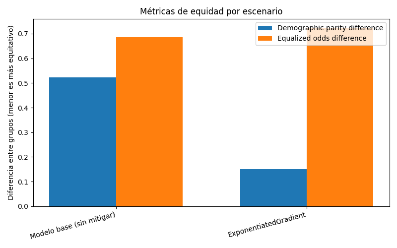
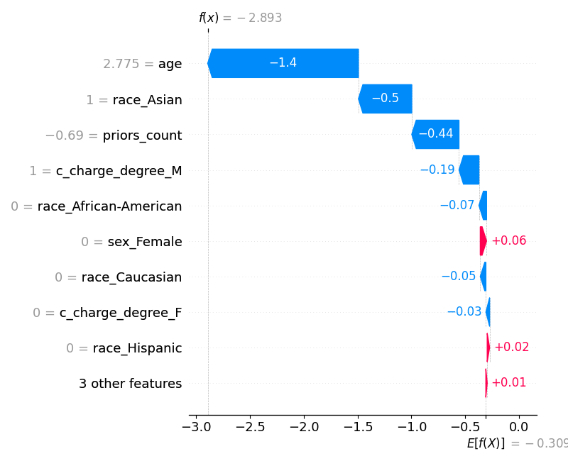
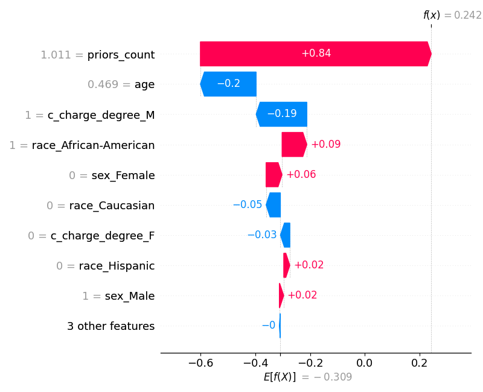
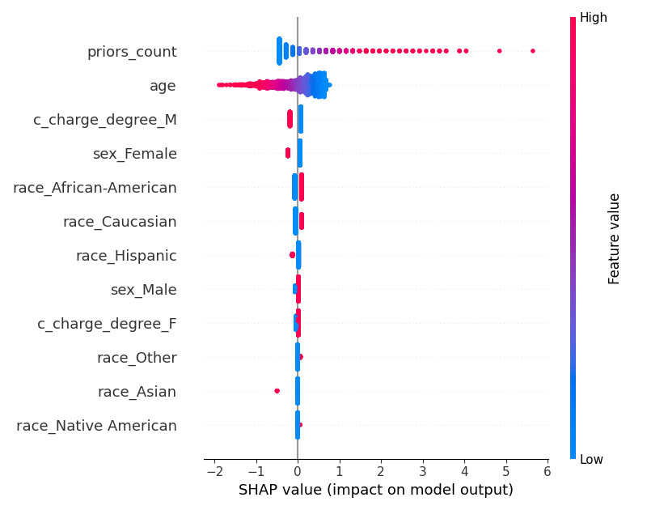

# Evidencias — Auditoría de equidad, mitigación y explicabilidad

_Generado automáticamente el 2026-10-19 05:08._

## Configuración de la corrida

- **Dataset:** data/compas_limpio.csv
- **Columna objetivo:** `two_year_recid` (clase positiva: `1`)
- **Atributo sensible:** `race`
- **Método de mitigación:** `ambos`
- **Restricción de equidad:** `demographic_parity`

## Auditoría de equidad — modelo base (pre-mitigación)

- **Exactitud global:** 0.676
- **Demographic parity difference:** 0.522
- **Equalized odds difference:** 0.685

### Métricas por grupo

| Grupo | Exactitud | Tasa de selección |
|---|---|---|
| African-American | 0.676 | 0.522 |
| Asian | 0.727 | 0.000 |
| Caucasian | 0.667 | 0.262 |
| Hispanic | 0.660 | 0.184 |
| Native American | 0.500 | 0.500 |
| Other | 0.763 | 0.186 |

> TODO estudiante: interpretá esta tabla vinculándola con el sesgo documentado en el caso real analizado en la consigna 3 (¿el patrón que ves acá es consistente con lo que reportó el caso?).

## Comparación antes / después de la mitigación

| Escenario | Exactitud | Demographic parity diff. | Equalized odds diff. |
|---|---|---|---|
| Modelo base (sin mitigar) | 0.676 | 0.522 | 0.685 |
| ExponentiatedGradient | 0.652 | 0.455 | 0.625 |
| ThresholdOptimizer | 0.668 | 0.404 | 0.655 |

> TODO estudiante: discutí qué tan efectiva resultó la mitigación aplicada y qué limitaciones observaste (consigna 9.c) — por ejemplo, si mejoró la equidad pero bajó la exactitud, o si algún escenario no logró reducir la disparidad.

## Explicabilidad (SHAP) — modelo base

SHAP se aplica siempre sobre el modelo base, antes de cualquier mitigación: el objetivo es ver qué técnica de auditoría preventiva podría haber detectado el problema antes del despliegue (consigna 4).

### Predicción 191 — el atributo sensible más influyó

- Contribución absoluta de `race`: 0.645
- Predicción del modelo: 0 · Valor real: 0

### Predicción 1 — el atributo sensible casi no influyó

- Contribución absoluta de `race`: 0.168
- Predicción del modelo: 1 · Valor real: 1

### Resumen global

> TODO estudiante: vinculá esta evidencia con la consigna 4 — ¿SHAP sobre el modelo base hubiera permitido detectar este problema antes del despliegue?
