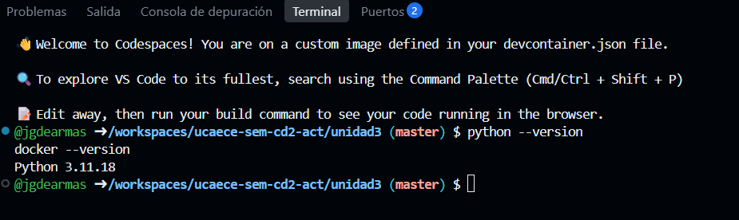
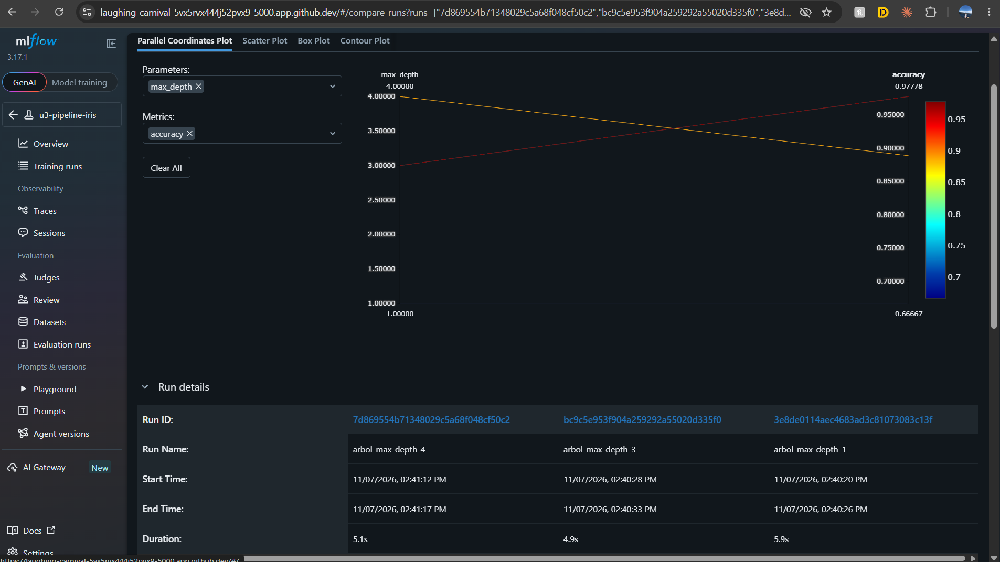
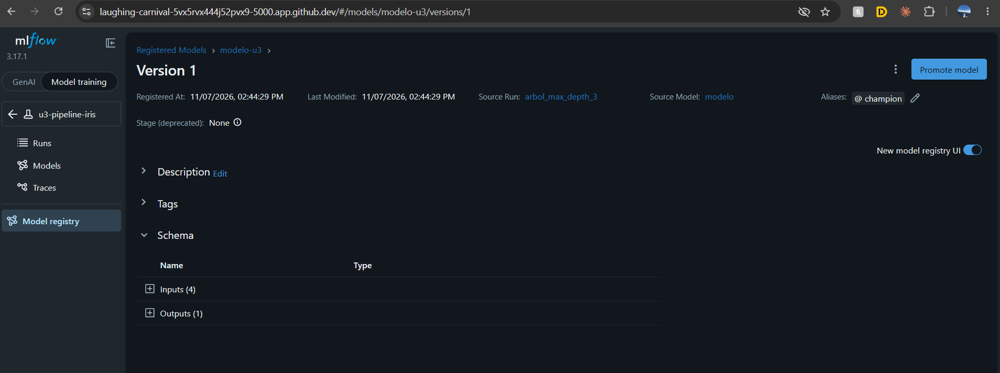
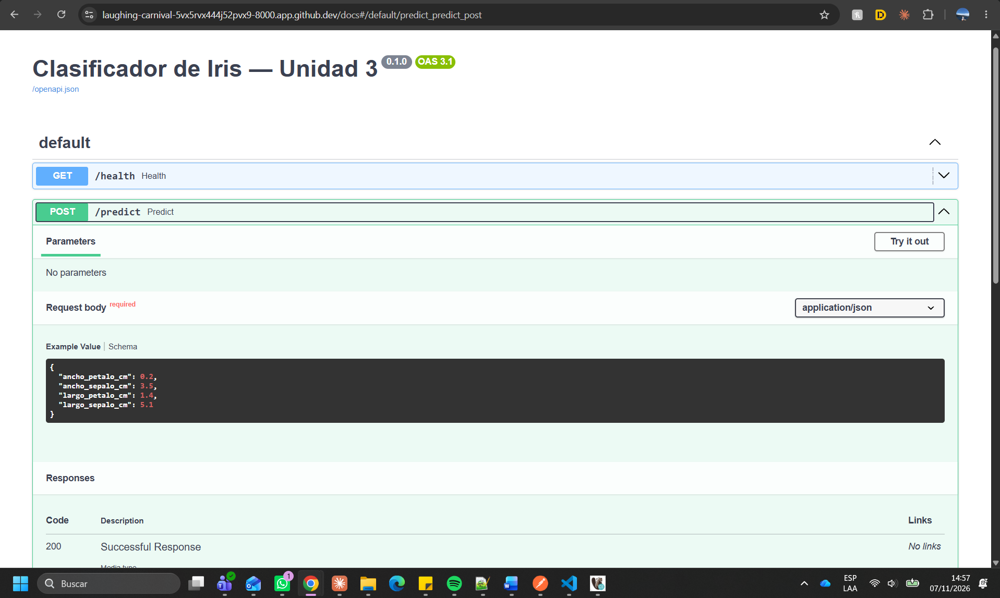
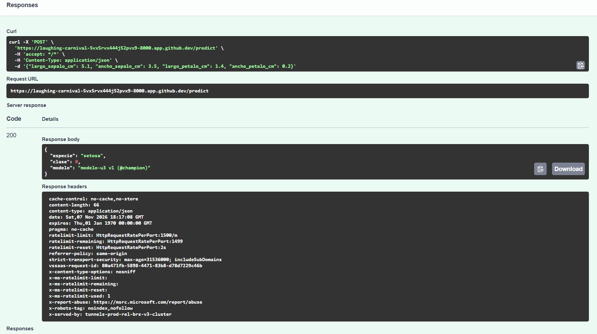

# Resultados — Unidad 3: MLOps/LLMOps

**Estudiante:** <!-- Completar con tu nombre y apellido -->
**Fecha:** <!-- Completar con la fecha de entrega -->

---

## Consigna 6: Preparación del entorno

---

## Consigna 7: Experimentación y registro con MLflow

| Corrida | max_depth | accuracy | f1_macro |
|---------|-----------|----------|----------|
|arbol_max_depth_1|1|0.667|0.556|
|arbol_max_depth_3|3|0.978|0.978|
|arbol_max_depth_4|4|0.889|0.889|

**Versión registrada:** modelo-u3 v__ (@champion), corrida con max_depth = __

> Escribí acá tu respuesta (3 a 5 líneas).
Al cambiar únicamente la profundidad máxima del árbol, el desempeño cambia de forma no lineal: con profundidad 1 el modelo es demasiado simple (accuracy 0.667) y no logra separar las tres especies; con profundidad 3 alcanza el mejor resultado (0.978); y con profundidad 4 empeora (0.889), lo que sugiere un comienzo de sobreajuste a los datos de entrenamiento. Esto muestra que más complejidad no implica mejor modelo. Conviene registrar todas las corridas, incluso las peores, porque MLflow guarda para cada una sus parámetros, métricas y modelo, lo que permite comparar de forma objetiva, reproducir cualquier resultado y justificar por qué una versión fue elegida como @champion.
---

## Consigna 8: Serving con FastAPI

| Entrada | Respuesta de la API |
|---------|---------------------|
|{"largo_sepalo_cm": 5.1, "ancho_sepalo_cm": 3.5, "largo_petalo_cm": 1.4, "ancho_petalo_cm": 0.2}         |	
Response body
Download
{
  "especie": "setosa",
  "clase": 0,
  "modelo": "modelo-u3 v1 (@champion)"
}|
|{"largo_sepalo_cm": 6.0, "ancho_sepalo_cm": 2.7, "largo_petalo_cm": 4.5, "ancho_petalo_cm": 1.4}|	
Response body
Download
{
  "especie": "versicolor",
  "clase": 1,
  "modelo": "modelo-u3 v1 (@champion)"
}|
|{"largo_sepalo_cm": 6.9, "ancho_sepalo_cm": 3.1, "largo_petalo_cm": 5.8, "ancho_petalo_cm": 2.2}|{
  "especie": "virginica",
  "clase": 2,
  "modelo": "modelo-u3 v1 (@champion)"
}|
|{"largo_sepalo_cm": "abc", "ancho_sepalo_cm": 3.1}|{
  "detail": [
    {
      "type": "float_parsing",
      "loc": [
        "body",
        "largo_sepalo_cm"
      ],
      "msg": "Input should be a valid number, unable to parse string as a number",
      "input": "abc"
    },
    {
      "type": "missing",
      "loc": [
        "body",
        "largo_petalo_cm"
      ],
      "msg": "Field required",
      "input": {
        "largo_sepalo_cm": "abc",
        "ancho_sepalo_cm": 3.1
      }
    },
    {
      "type": "missing",
      "loc": [
        "body",
        "ancho_petalo_cm"
      ],
      "msg": "Field required",
      "input": {
        "largo_sepalo_cm": "abc",
        "ancho_sepalo_cm": 3.1
      }
    }
  ]
}|

> Escribí acá tu respuesta (3 a 5 líneas).

--- 
Ante el dato inválido ("largo_sepalo_cm": "abc" y faltantes los otros tres campos), la API respondió con un código 422 y un detalle de los campos que no cumplen el contrato (tipo numérico mayor que cero, campos obligatorios), sin llegar a ejecutar el modelo: la validación ocurre antes de la predicción, a partir del contrato declarado en la API. Este comportamiento es importante en producción porque el modelo recibe datos de otros sistemas que no controlamos: sin esa barrera, un dato malformado podría producir un error interno, o peor, una predicción silenciosamente incorrecta que nadie detecte. Rechazar la entrada con un mensaje claro protege al modelo, facilita el diagnóstico del sistema que envía mal los datos y evita que resultados erróneos circulen como si fueran válidos.

## Consigna 9: Containerización con Docker

Si existiera modelo-u3:1.1, tener ambas imágenes etiquetadas e inmutables permitiría aplicar blue-green sin tocar el código: la versión 1.0 seguiría corriendo como entorno “blue” (en producción) mientras se levanta 1.1 como entorno “green” en paralelo, con el mismo contrato de API. Allí se la validaría contra el set de consultas de prueba y, una vez confirmada, se conmutaría todo el tráfico de una a otra cambiando solo a qué imagen apunta el servicio (por ejemplo, la etiqueta en el servicio gestionado de contenedores). Como la imagen 1.0 queda intacta y disponible, el rollback ante cualquier problema consiste en volver a apuntar el tráfico a 1.0, sin reconstruir nada. Además, cada imagen lleva empaquetado su propio modelo, por lo que la versión del modelo que responde (visible en la respuesta de la API) queda ligada a la etiqueta de la imagen, lo que da trazabilidad
---

## Paso opcional: LLMOps con Groq

| Plantilla | tasa_exito | tokens_totales | latencia_media_s |
|-----------|------------|----------------|------------------|
| zero_shot |            |                |                  |
| few_shot  |            |                |                  |

> Escribí acá tu interpretación (2 a 3 líneas).
